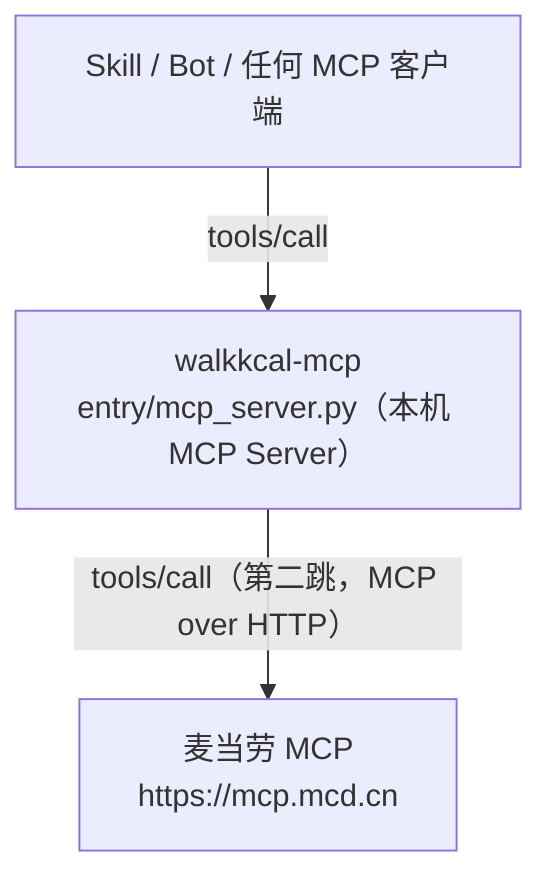

# MCP 集成说明

> **本文给谁看**：评委（技术评审）—— 用了哪些 MCP Tool、调用流程、业务价值。

> 本文说明walk-kcal **实际使用了哪些 MCP Server / Tool、调用流程、业务价值**。

---

## 一、使用的 MCP Server 与 Tool

| MCP Server | 地址 | Tool | 用途 | 必需 |
|---|---|---|---|---|
| **麦当劳 MCP** | `https://mcp.mcd.cn` | `list-nutrition-foods` | 官方营养数据（158 条，含热量/蛋白/脂肪/碳水/钠/钙） | ★ **必需** |
| 麦当劳 MCP | `https://mcp.mcd.cn` | `query-nearby-stores` | 门店检索与距离 | 推荐 |
| 麦当劳 MCP | `https://mcp.mcd.cn` | `query-meals` / `query-my-coupons` | 套餐与券（扩展用） | 可选 |
| **高德 MCP** | `https://mcp.amap.com` | 周边检索 / 步行路径 | 本地餐厅 POI + 真实路网距离 | 推荐 |

配置见仓库根 `mcp-config.example.json`（**只含 `${MCD_MCP_TOKEN}` 占位符**）。

---

## 二、★ 关键实现：MCP 调 MCP

`entry/mcp_server.py` 是一个**真实的 MCP Server**（stdio + JSON-RPC 2.0），
它内部会**去调麦当劳 MCP**（第二跳），把官方营养表与本地的中餐估算**融合**：



这把「用一次 MCP」升级为「**把 MCP 能力编排进一个更大的算法层**」。

---

## 三、调用流程

```
① initialize            → 协商协议版本 2025-06-18
② tools/list            → 暴露 4 个工具
③ tools/call list-nutrition-foods
       ↓ 返回自定义文本格式（★ 非 JSON）：
         name,kcal,protein,fat,carb,sodium,calcium      ← 9 列
       ↓ 逐行解析 + 去重（160 → 158）
④ 门店：麦当劳 MCP query-nearby-stores
       ★ 它只吃文字（city + keyword），不收经纬度 →
         坐标先经地图逆地理编码翻译成「城市 + 最近路名」再喂进去
       ★ 通用接口本身仍是经纬度：翻译发生在麦当劳的适配层
         （packs/pack_mcd.py），其它渠道一行都不用改
⑤ 与本地数据融合：
       麦当劳门店  → MCP 官方热量（精确，100% 覆盖）
       本地餐厅    → 自建语料库估算（覆盖 37%，算不出则弃权）
⑥ 叠额度：quota = 450 + (walk//80+1)×4
⑦ 判档：每道菜 吃下 / 超了；每家店 低于/适配/高于缺口
```

---

## 四、业务价值

### 1. 麦当劳 MCP 是「权威数据源」，不是「产品边界」

| 场景 | 数据来源 | 覆盖 |
|---|---|---|
| 麦当劳门店的菜 | MCP `list-nutrition-foods` | **100% 精确** |
| 周边本地餐厅的菜 | 自建语料库 155 万条 | 37%（算不出则弃权） |

有了这个官方测定的基准，才能回答「麦当劳和隔壁那家比，差多少」。

### 2. 用官方数据做校准基准

中餐估算误差 25–28%。麦当劳 MCP 的精确值提供了**交叉验证的锚点** ——
「隔壁那家面馆的热量，是我们用 155 万条菜谱估算的；麦当劳的，
是官方测定的。两者放一起看，才知道差距有多大。」

### 3. 「MCP 调 MCP」展示可编排性

麦当劳 MCP 是**能力**，不是**终点**。我们的 MCP Server 把它包进一个
更大的算法层（额度引擎 + 多源融合），任何 MCP 客户端都能一次性拿到
「融合后的结论」，而不用自己编排多个 MCP。

---

## 五、离线回退

评委/访客**不申请 Token 也能看到完整效果**：
- `packs/mcd_nutrition_snapshot.py` 保存了 MCP 实测快照（2026-10-09）
- `packs/pack_mcd.py` 在无 Token 时自动回退到快照
- 界面上标注「数据快照日期」，不假装是实时值
- ★ 每行门店带 `src`（`mcp` / `snapshot`），回退原因写进 `registry.notes()` ——
  **「本该实时、实际是快照」这件事看得见**，不会静默冒充

★ 想跑**实时门店检索**（`query-nearby-stores`）需要**两个 Key**：

| Key | 干什么 | 缺了会怎样 |
|---|---|---|
| `MCD_MCP_TOKEN` | 调得动麦当劳 MCP | 读本地快照（默认路径） |
| `AMAP_KEY` | 把坐标翻译成 `city`/`keyword` | 连 MCP 都不调，回退快照并说明原因 |
