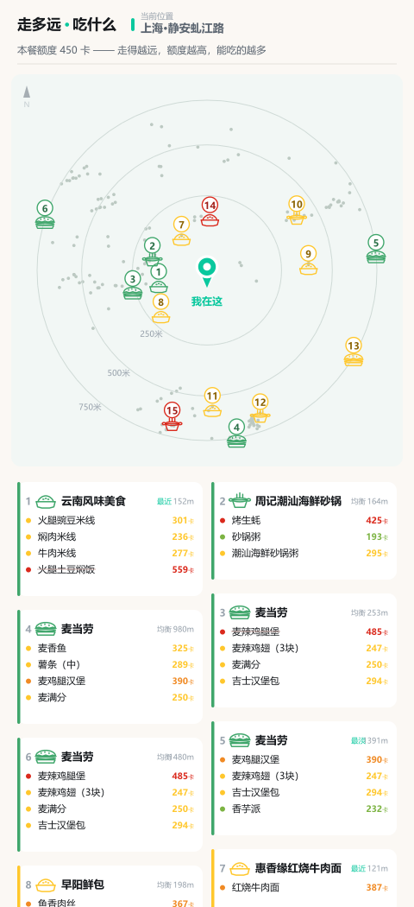
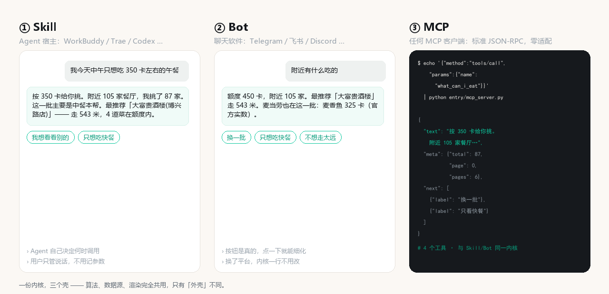
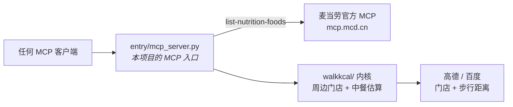

# walk-kcal

**你今天还能吃多少卡，取决于你愿意走多远。**

*麦当劳程序员节创意开发大赛参赛作品*

### 👉 [在线体验（免安装）](https://adexbn.github.io/walk-kcal/) ｜ 想在本机跑 → [快速开始](docs/快速开始.md)

---

## 站在楼下，饿着，纠结「现在吃什么」

打开手机，满屏都是「附近美食」。可你真正想知道的是：

> **这一顿，我吃得下吗？**

walk-kcal 把这个纠结变成一道算术题：

```
你走到那家店，路上消耗的卡路里，就是你这一顿多出来的额度。
走得越远，额度越高，能吃的越多。
```

然后告诉你：附近哪家店、哪道菜**你这顿吃不吃得下**。

<p align="center">
  <br>
  <sub>绿色 = 吃得起 · 红色 = 超了（划掉） · 一张图直接发微信 / 小红书</sub>
</p>

---

## 反常识：麦当劳居然是个低热量选项

我们把 158 条麦当劳官方营养数据、155 万条中餐菜谱摊在一起算了一遍。

- 麦香鱼 **325 卡** · 麦满分 250 卡 · 迷你草莓新地 122 卡
- 而隔一条街那家面馆的红烧肉盖饭，**780 卡起步**

**同一街区里，麦当劳的推荐菜大多落在普通人的一餐额度之内。**

这不是我们编的，是算出来的。

> 对热量预算紧张的人来说，**走进麦当劳，反而是最安全的选择。**

---

## 同一份内核，三个壳

同一句「附近吃什么」，从三种地方问出来，拿到的是**同一份结果** ——
算法、数据源、渲染完全共用，只有「外壳」不同。

<p align="center">
  
</p>

| 壳 | 给谁用 | 怎么用 |
|---|---|---|
| **① Skill** | Agent 用户 | 说一句「附近吃什么」，Agent 自己判断何时调用 —— 不用记参数 |
| **② Bot** | 聊天软件用户 | 在 Telegram / 飞书 / Discord 里发消息，回复带真按钮 |
| **③ MCP** | 任何 MCP 客户端 | 标准 JSON-RPC，4 个工具，零适配 |

> 上面那张图里的对话**不是编的** —— 是实跑 `data/linghelu`（上海浦东凌河路）
> 拿到的真实回复，截图自 WorkBuddy 界面。

---

## 内置两款能力 —— 也可以接你自己的

这个 demo 自带两款数据源，开箱即用：

| 能力 | 供什么 | 来源 |
|---|---|---|
| **麦当劳** | 门店 + 推荐菜 + **官方精确营养值**（158 条，含蛋白/脂肪/碳水/钠/钙） | 麦当劳官方 MCP |
| **高德地图** | 周边**任意**餐厅 + 网友推荐菜 + **真实路网**步行距离 | 高德开放平台 |

### 麦当劳有两条通道 —— 一个 Token 就能走实时

| 通道 | 怎么开 | 拿到什么 |
|---|---|---|
| **实时 MCP**（正路） | `MCD_MCP_TOKEN` + `WALKKCAL_MCD_LIVE=1` | 门店与营养值都**实时**从 `mcp.mcd.cn` 拉 |
| **内嵌快照**（默认降级） | 什么都不用配 | 158 条官方营养值（2026-10-09 快照）+ 内置门店 |

★ **`MCD_MCP_TOKEN` 的唯一用途就是走实时 MCP。**
内嵌快照只是「**没配 Token 时的降级**」—— 让项目能被零门槛跑起来，而不是一上来就报错。

**实测对照**（同一坐标 `121.601780, 31.272460`，通道不同，门店也完全不同）：

| 通道 | 返回的门店 | 来源标记 |
|---|---|---|
| 内嵌快照 | 麦当劳(虬江路店) 253 m —— **只有 1 家** | `src=snapshot` |
| **实时 MCP** | 五莲路餐厅 984 m · 浦东金桥大拇指广场 1035 m · 金桥餐厅 1078 m…（**5 家**） | `src=mcp` |

Token 在 https://open.mcd.cn/mcp 免费申请（登录麦当劳账号 → 激活 → 复制）。

**可以按需组合** —— 一个环境变量的事：

| 你想要的 | 怎么配 | 你会拿到 |
|---|---|---|
| 两个都要（**默认**） | 不设 | 麦当劳与周边餐厅**合并成一份结果** |
| **只要麦当劳** | `WALKKCAL_PACKS=mcd` | 只有麦当劳，全部官方精确值 |
| **只要周边餐厅**（即「只要地图」） | `WALKKCAL_PACKS=nearby` | 只有你楼下那些面馆、火锅、小吃 |

**也可以接你自己的** —— 点评的企业接口、美团、或者你手上任何一份门店／菜品数据。
数据源是**可插拔**的：加一个文件 + 一个环境变量，**主流程 0 行改动**。

> 麦当劳在这里是一个**可信的数据源**，不是一个**产品的边界**。

---

## 为什么是我们

我们把这个赛道的 493 个报名翻了一遍：

| | 数量 | 发现 |
|---|---|---|
| 热量/营养类项目 | **226 个** | 全都在算**麦当劳自己的菜** |
| 提到「步行/距离」 | 79 个 | 只有 **9 个**和热量挂钩 |
| 做「麦当劳 + 周边本地 + 步行额度」 | **0 个** | 这就是我们的位置 |

麦当劳 MCP 开放的，是**它自己的**营养表。
可真实场景里，**你 400 米外那家面馆、那家潮汕火锅，多少卡？**

**没有人做这件事。我们做了。**

---

## 我们诚实地告诉你

**中餐热量是估算的，平均误差 25–28%。** 麦当劳的数据是 MCP 官方精确值。

因为语料库里 **0% 的菜谱标注了份量**，同一道菜的量级能差 40 倍。
我们花最多力气的地方，不是「算得更准」，而是**知道什么时候算不准 ——
然后老老实实显示「算不出」，而不是猜一个看起来正常的数字。**

> 宁可少算，不可算错。　详见 → [`docs/数据源与误差.md`](docs/数据源与误差.md)

---

<div align="right"><sub>↓ 以下是给想动手的人看的：怎么跑 · 怎么接 · 用了什么</sub></div>

---

## 跑起来

**先跑内置场景 —— 这一步一个 Key 都不需要。**

```bash
git clone https://github.com/adexbn/walk-kcal && cd walk-kcal
python walkkcal/render.py     # 出图（内置场景，1~2 秒）
open demo/explore.html        # 离线可交互 demo
```

快照里已经存好了门店、推荐菜、**步行距离**和热量 —— 麦当劳那 158 条官方营养值也是**内嵌**的。
所以「先跑起来看看」这件事，零门槛。

### Key 用在哪

| 你想做 | 需要什么 |
|---|---|
| 跑**内置场景**（出图 / 翻页 / 筛选） | **什么都不用** —— 快照里全都有 |
| 抓**你自己楼下**的点位 | `AMAP_KEY` |
| 麦当劳走**实时 MCP**（而非内嵌快照） | `MCD_MCP_TOKEN` + `WALKKCAL_MCD_LIVE=1` |

> 麦当劳两条通道的实测对照（同一坐标，门店完全不同）见上文「内置两款能力」。

```bash
# 抓新点位：地址 → 坐标 → 抓数 → 出图，实测约 16 秒
python walkkcal/shoot.py "上海市黄浦区南京东路100号"
```

### 想换组合？

```bash
WALKKCAL_PACKS=mcd     python walkkcal/render.py   # 只看麦当劳（全部官方精确值）
WALKKCAL_PACKS=nearby  python walkkcal/render.py   # 只看周边餐厅（即「只要地图」）
```

跑起来会打印一行「源装配」，告诉你这次到底用了谁 —— **退化会显形，不会静默变空**：

```
源装配：麦当劳(店✓ 菜✓ 热✓官方) ｜ 周边餐厅(店✓ 菜✓ 热✓估算)
```

> 全部命令、5 个内置实拍场景、换点位、跨城市、环境变量总表
> → [`docs/快速开始.md`](docs/快速开始.md)

### 出图依赖是可选增强，不是前置条件

| 你的环境 | 跑一次会怎样 | 你拿到什么 |
|---|---|---|
| **什么都不装** | 正常跑完，**退出码 0**，不报错 | **一张 SVG**（480×1976 竖屏长图；浏览器打开无损、放大不糊） |
| `pip install -r requirements.txt` | 同上，只多一步位图化 | **SVG + PNG 两张**（PNG 方便直接发微信 / 小红书） |

缺包时**自动降级为「只出 SVG」**，**不会让你撞 `ImportError`**。
业务内容（店名 / 菜名 / 热量 / 距离）与 PNG **完全一致**，差异只在位图化。
两个包都有预编译 wheel，实测 9 秒装完，不需要本地编译工具链 —— 这是**唯一**的第三方依赖。

---

## ★ 真的用了麦当劳 MCP —— 而且是「MCP 调 MCP」

赛事硬性要求「须真实使用麦当劳 MCP 能力」，这条链路是实的：



本项目的 MCP 入口 [`entry/mcp_server.py`](entry/mcp_server.py) 对外暴露 4 个工具 ——
`walk_allowance` / `nearby_food` / `what_can_i_eat` / `explain_concept`；
**它自己内部还会再去调麦当劳官方 MCP**：`packs/pack_mcd.py` 用 JSON-RPC 打
`https://mcp.mcd.cn` 的 `list-nutrition-foods`，拿回 **158 条官方营养值**（含蛋白/脂肪/碳水/钠/钙），
与本地中餐菜谱估算**融合成一个统一结果**。

**最硬的一条实测证据** —— 同一个坐标，门店变了：

| | 门店 | 距离 | 来源 |
|---|---|---|---|
| 走快照 | 麦当劳(四川北路店) | 1391 m | 本地 JSON |
| **走实时** | **麦当劳上海闸北虬江路永兴汇餐厅** | **792 m** | MCP `query-nearby-stores` |

「永兴汇餐厅」这家**本地快照里根本没有** —— 只有真调 MCP 才会冒出来。
完整证据（含 35 个工具清单、158 条营养表逐条比对、7 条错值修正）→ [`evidence-real.md`](evidence-real.md)
调用流程与 Tool 清单 → [`MCP_INTEGRATION.md`](MCP_INTEGRATION.md)

```bash
# 不填任何 Token 也能自测（读本地快照）
printf '%s\n' '{"jsonrpc":"2.0","id":1,"method":"tools/list"}' | python entry/mcp_server.py
```

---

## 工程能力（想动手的直接看这段）

`walkkcal/` 是内核（额度算法 · 数据源 · 渲染），上面三个壳都只是它的包装。
除「出图」那两颗 wheel 外**零第三方依赖** —— 抓数 / 额度 / 选店 / 热量全是标准库。

**换任何一环都不用改主流程：**

| 你想换 | 要改什么 | 主流程改动 |
|---|---|---|
| 地图（高德 → 百度/腾讯） | 加 `providers/geo_xxx.py` 一个文件 | **0 行** |
| 语料（下厨房 → 点评/薄荷） | 加 `providers/corpus_xxx.py` 一个文件 | **0 行** |
| **渠道**（启用/禁用某个数据源） | 设 `WALKKCAL_PACKS` | **0 行** |
| 接一整家新品牌（如接一个自有门店库） | 加 `packs/pack_xxx.py` 一个文件 | **0 行** |

**换语料也不会把覆盖率打回原形**：查热量是分层的，
L2（菜名品类）/ L3（门店类型）先验与语料源无关，永远生效。

📖 想接新数据源 → [`docs/扩展开发.md`](docs/扩展开发.md)

---

## 文档地图

**想用** · [快速开始](docs/快速开始.md) ｜ [交互模式](docs/交互模式.md) ｜ [离线 demo](demo/explore.html)
**想懂** · [设计取舍](docs/设计取舍.md) ｜ [数据源与误差](docs/数据源与误差.md) ｜ [工程历程](docs/工程历程.md)
**想接** · [扩展开发](docs/扩展开发.md) ｜ [源装配契约](docs/源装配契约.md) ｜ [服务商边界](docs/服务商边界.md)
**评委** · [MCP_INTEGRATION.md](MCP_INTEGRATION.md) ｜ [evidence-real.md](evidence-real.md) ｜ [SKILL.md](SKILL.md)

---

## 免责

本项目为麦当劳程序员节创意开发大赛参赛作品，**由参赛者独立开发，非麦当劳官方产品**。
输出仅供参考，不构成医疗、营养或其他专业建议。
餐品信息、价格及供应状态以麦当劳官方渠道的实时结果为准。

---

<div align="center">

**你今天还能吃多少卡，取决于你愿意走多远。**

如果这个想法让你想多走两步 —— 给个 ⭐ 吧。

</div>
