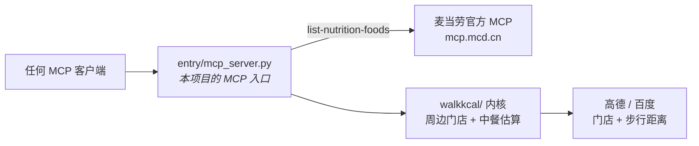

# walk-kcal

**你今天还能吃多少卡，取决于你愿意走多远。**

*麦当劳程序员节创意开发大赛参赛作品*

### 👉 [在线体验（免安装）](https://adexbn.github.io/walk-kcal/) ｜ 想在本机跑 → [快速开始](docs/快速开始.md)

---

## 站在楼下，饿着，纠结「现在吃什么」

打开手机，满屏都是「附近美食」。可你真正想知道的是：

> **这一顿，我吃得下吗？**

walk-kcal 把这个纠结变成一道算术题：

```
你走到那家店，路上消耗的卡路里，就是你这一顿多出来的额度。
走得越远，额度越高，能吃的越多。
```

然后告诉你：附近哪家店、哪道菜**你这顿吃不吃得下**。

<p align="center">
  <br>
  <sub>绿色 = 吃得起 · 红色 = 超了（划掉） · 一张图直接发微信 / 小红书</sub>
</p>

---

## 反常识：麦当劳居然是个低热量选项

我们把 158 条麦当劳官方营养数据、155 万条中餐菜谱摊在一起算了一遍。

- 麦香鱼 **325 卡** · 麦满分 250 卡 · 迷你草莓新地 122 卡
- 而隔一条街那家面馆的红烧肉盖饭，**780 卡起步**

**同一街区里，麦当劳的推荐菜大多落在普通人的一餐额度之内。**

这不是我们编的，是算出来的。

> 对热量预算紧张的人来说，**走进麦当劳，反而是最安全的选择。**

---

## 同一份内核，三个壳

同一句「附近吃什么」，从三种地方问出来，拿到的是**同一份结果** ——
算法、数据源、渲染完全共用，只有「外壳」不同。

<p align="center">
  
</p>

| 壳 | 给谁用 | 怎么用 |
|---|---|---|
| **① Skill** | Agent 用户 | 说一句「附近吃什么」，Agent 自己判断何时调用 —— 不用记参数 |
| **② Bot** | 聊天软件用户 | 在 Telegram / 飞书 / Discord 里发消息，回复带真按钮 |
| **③ MCP** | 任何 MCP 客户端 | 标准 JSON-RPC，4 个工具，零适配 |

> 上面那张图里的对话**不是编的** —— 是实跑 `data/linghelu`（上海浦东凌河路）
> 拿到的真实回复，截图自 WorkBuddy 界面。

---

## 为什么是我们

我们把这个赛道的 493 个报名翻了一遍：

| | 数量 | 发现 |
|---|---|---|
| 热量/营养类项目 | **226 个** | 全都在算**麦当劳自己的菜** |
| 提到「步行/距离」 | 79 个 | 只有 **9 个**和热量挂钩 |
| 做「麦当劳 + 周边本地 + 步行额度」 | **0 个** | 这就是我们的位置 |

麦当劳 MCP 开放的，是**它自己的**营养表。
可真实场景里，**你 400 米外那家面馆、那家潮汕火锅，多少卡？**

**没有人做这件事。我们做了。**

所以我们把数据源做成了**可插拔**的 —— 麦当劳只是其中一个包。
接一个新品牌，**30 行代码**。

> 麦当劳在这里，是一个**可信的数据源**，不是一个**产品的边界**。

---

## 我们诚实地告诉你

**中餐热量是估算的，平均误差 25–28%。** 麦当劳的数据是 MCP 官方精确值。

因为语料库里 **0% 的菜谱标注了份量**，同一道菜的量级能差 40 倍。
我们花最多力气的地方，不是「算得更准」，而是**知道什么时候算不准 ——
然后老老实实显示「算不出」，而不是猜一个看起来正常的数字。**

> 宁可少算，不可算错。　详见 → [`docs/数据源与误差.md`](docs/数据源与误差.md)

---

<div align="right"><sub>↓ 以下是给想动手的人看的：怎么跑 · 怎么接 · 用了什么</sub></div>

---

## 跑起来

```bash
git clone https://github.com/adexbn/walk-kcal && cd walk-kcal

# ① 离线 demo —— 不需要 Key、不需要 Token、不需要装任何包
open demo/explore.html

# ② 直接出一张图（需要 AMAP_KEY —— 配置只需一步，见快速开始）
python walkkcal/shoot.py "上海市黄浦区南京东路100号"
```

**只需一个 Key。** 麦当劳 Token 是**可选的**（不填则读本地快照，界面会如实标注快照日期）。

> 全部命令、5 个内置实拍场景、换点位、跨城市、环境变量总表
> → [`docs/快速开始.md`](docs/快速开始.md)

### 出图依赖是可选增强，不是前置条件

| 你的环境 | 跑一次会怎样 | 你拿到什么 |
|---|---|---|
| **什么都不装** | 正常跑完，**退出码 0**，不报错 | **一张 SVG**（480×1976 竖屏长图；浏览器打开无损、放大不糊） |
| `pip install -r requirements.txt` | 同上，只多一步位图化 | **SVG + PNG 两张**（PNG 方便直接发微信 / 小红书） |

缺包时**自动降级为「只出 SVG」**，**不会让你撞 `ImportError`**。
业务内容（店名 / 菜名 / 热量 / 距离）与 PNG **完全一致**，差异只在位图化。
两个包都有预编译 wheel，实测 9 秒装完，不需要本地编译工具链 —— 这是**唯一**的第三方依赖。

---

## ★ 真的用了麦当劳 MCP —— 而且是「MCP 调 MCP」

赛事硬性要求「须真实使用麦当劳 MCP 能力」，这条链路是实的：



本项目的 MCP 入口 [`entry/mcp_server.py`](entry/mcp_server.py) 对外暴露 4 个工具 ——
`walk_allowance` / `nearby_food` / `what_can_i_eat` / `explain_concept`；
**它自己内部还会再去调麦当劳官方 MCP**：`packs/pack_mcd.py` 用 JSON-RPC 打
`https://mcp.mcd.cn` 的 `list-nutrition-foods`，拿回 **158 条官方营养值**（含蛋白/脂肪/碳水/钠/钙），
与本地中餐菜谱估算**融合成一个统一结果**。

**最硬的一条实测证据** —— 同一个坐标，门店变了：

| | 门店 | 距离 | 来源 |
|---|---|---|---|
| 走快照 | 麦当劳(四川北路店) | 1391 m | 本地 JSON |
| **走实时** | **麦当劳上海闸北虬江路永兴汇餐厅** | **792 m** | MCP `query-nearby-stores` |

「永兴汇餐厅」这家**本地快照里根本没有** —— 只有真调 MCP 才会冒出来。
完整证据（含 35 个工具清单、158 条营养表逐条比对、7 条错值修正）→ [`evidence-real.md`](evidence-real.md)
调用流程与 Tool 清单 → [`MCP_INTEGRATION.md`](MCP_INTEGRATION.md)

```bash
# 不填任何 Token 也能自测（读本地快照）
printf '%s\n' '{"jsonrpc":"2.0","id":1,"method":"tools/list"}' | python entry/mcp_server.py
```

---

## 工程能力（想动手的直接看这段）

`walkkcal/` 是内核（额度算法 · 数据源 · 渲染），上面三个壳都只是它的包装。
除「出图」那两颗 wheel 外**零第三方依赖** —— 抓数 / 额度 / 选店 / 热量全是标准库。

**换任何一环都不用改主流程：**

| 你想换 | 要改什么 | 主流程改动 |
|---|---|---|
| **渠道**（启用/禁用某个数据源） | 设 `WALKKCAL_PACKS=mcd` 或 `nearby` | **0 行** |
| 地图（高德 → 百度/腾讯） | 加 `providers/geo_xxx.py` 一个文件 | **0 行** |
| 语料（下厨房 → 点评/薄荷） | 加 `providers/corpus_xxx.py` 一个文件 | **0 行** |

跑起来会打印一行「源装配」，告诉你每样数据来自谁 —— **退化会显形，不会静默变空**：

```
源装配：麦当劳(店✓ 菜✓ 热✓官方) ｜ 周边餐厅(店✓ 菜✓ 热✓估算)
```

**换语料也不会把覆盖率打回原形**：查热量是分层的，
L2（菜名品类）/ L3（门店类型）先验与语料源无关，永远生效。

📖 想接新数据源 → [`docs/扩展开发.md`](docs/扩展开发.md)

---

## 文档地图

**想用** · [快速开始](docs/快速开始.md) ｜ [交互模式](docs/交互模式.md) ｜ [离线 demo](demo/explore.html)
**想懂** · [设计取舍](docs/设计取舍.md) ｜ [数据源与误差](docs/数据源与误差.md) ｜ [工程历程](docs/工程历程.md)
**想接** · [扩展开发](docs/扩展开发.md) ｜ [源装配契约](docs/源装配契约.md) ｜ [服务商边界](docs/服务商边界.md)
**评委** · [MCP_INTEGRATION.md](MCP_INTEGRATION.md) ｜ [evidence-real.md](evidence-real.md) ｜ [SKILL.md](SKILL.md)

---

## 免责

本项目为麦当劳程序员节创意开发大赛参赛作品，**由参赛者独立开发，非麦当劳官方产品**。
输出仅供参考，不构成医疗、营养或其他专业建议。
餐品信息、价格及供应状态以麦当劳官方渠道的实时结果为准。

---

<div align="center">

**你今天还能吃多少卡，取决于你愿意走多远。**

如果这个想法让你想多走两步 —— 给个 ⭐ 吧。

</div>
