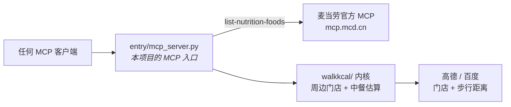
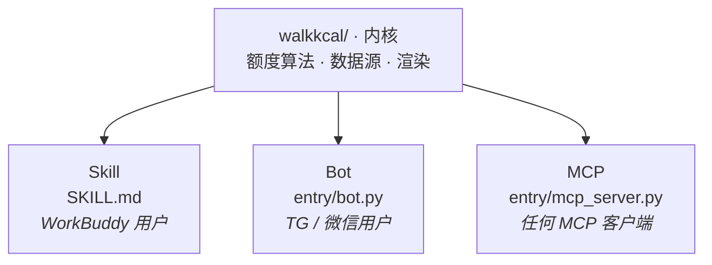

# walk-kcal

> ## 你今天还能吃多少卡，取决于你愿意走多远。
>
> *麦当劳程序员节创意开发大赛参赛作品*

---

## 站在楼下，饿着，纠结「现在吃什么」

打开手机，满屏都是「附近美食」。可你真正想知道的是：

> **这一顿，我吃得下吗？**

walk-kcal 把这个纠结，变成一道**算术题**：

```
你走到那家店，路上消耗的卡路里，就是你这一顿多出来的额度。
走得越远，额度越高，能吃的越多。
```

然后它告诉你：附近哪家店、哪道菜**你这顿吃不吃得下** ——
绿色 = 吃得起，红色 = 超了（划掉）。


同一份能力，换成人问人答的对话（图为界面示意，文案是真实产出）：


---

## 然后我们发现了一件反常识的事

我们把 158 条麦当劳官方营养数据、155 万条中餐菜谱摊在一起算了一遍。

结果：**同一街区里，麦当劳的推荐菜，热量大多落在普通人的一餐额度之内。**

> **麦当劳，居然是个低热量选项。**

这不是我们编的，是算出来的。

- 麦香鱼 **325 卡** · 麦满分 250 卡 · 迷你草莓新地 122 卡
- 而隔壁那家面馆的红烧肉盖饭，**780 卡起步**

对那些热量预算紧张的人来说，**走进麦当劳，反而是最安全的选择。**

---

## 它做什么

| 你说 | 它做 |
|---|---|
| 「我现在还能吃 450 卡，附近有什么能吃的」 | 算额度、列附近店、每道菜标「吃得下 / 超了」 |
| 「走过去 500 米能多吃多少」 | 走 500 米 ≈ 多挣 28 卡，额度实时重算 |
| 「麦当劳和隔壁面馆哪个更合适」 | 同一额度下对比热量，一眼看出差距 |
| 「这家店整体会不会吃超」 | 按推荐菜整体相对额度给店铺定性：🟢 🟡 🔴 |

**输出**：一张竖屏长图，可以直接发微信、发小红书。

---

## ★ 用了麦当劳 MCP —— 而且是「MCP 调 MCP」

赛事硬性要求「须真实使用麦当劳 MCP 能力」，所以先把这条链路说清楚：



本项目的 MCP 入口 [`entry/mcp_server.py`](entry/mcp_server.py) 对外暴露 4 个工具 ——
`walk_allowance` / `nearby_food` / `what_can_i_eat` / `explain_concept`；
**它自己内部还会再去调麦当劳官方 MCP**：`packs/pack_mcd.py` 用 JSON-RPC 打
`https://mcp.mcd.cn` 的 `list-nutrition-foods`，拿回 **158 条官方营养值**（含蛋白/脂肪/碳水/钠/钙），
与本地中餐菜谱估算**融合成一个统一结果**。

**自测（不填任何 Token，读本地快照）：**

```bash
printf '%s\n' '{"jsonrpc":"2.0","id":1,"method":"tools/list"}' | python entry/mcp_server.py
```

**接实时麦当劳 MCP（拿官方营养值，而不是快照）：**

```bash
# ★ Key / Token 一律走配置文件或环境变量，**不写进 .py**（见下）
cp config.example.json config.local.json    # 填 AMAP_KEY / MCD_MCP_TOKEN
python walkkcal/config.py                   # 看当前取值从哪来（只报有没有，不打印值）
```

> ⚠️ **注意**：`packs/registry.py` 里麦当劳默认 `offline=True` ——
> **只配 `AMAP_KEY` 时，麦当劳数据走本地快照，全程不发起 MCP 请求。**
> 要打开实时：`WALKKCAL_MCD_LIVE=1` + `MCD_MCP_TOKEN` + `AMAP_KEY`
> → `WALKKCAL_MCD_LIVE=1 python packs/registry.py`（会打印每条渠道的门店来源和回退原因）。
> 直连实测证据见 [`evidence-real.md`](evidence-real.md)。

### 配置与密钥（★ 不写进 `.py`）

Key 的唯一入口是 `walkkcal/config.py`，取值顺序 **环境变量 > `WALKKCAL_CONFIG` >
`config.local.json` > `walkkcal/config.local.json` > `../internal/config.local.json`**。
格式是 **JSON**（不是 YAML —— 零第三方依赖是硬约束，YAML 要拉 `PyYAML`）。

```bash
cp config.example.json config.local.json     # 模板 → 本地配置（已被 .gitignore 忽略）
# 提交前自检：仓库里有没有明文密钥（应无输出）
grep -rnE "[0-9a-f]{32}" --include='*.py' .
```

`config.local.json` **永远不进版本库**；报错文本里的 Key 会被 `config.redact()`
替换成 `<已屏蔽 XXX>`（Key 不会顺着异常信息漏进日志）。

---

## 三步跑起来（不填任何 Token 也能看效果）

```bash
git clone https://github.com/adexbn/walk-kcal && cd walk-kcal

# ① 浏览器打开离线 demo —— 不需要任何凭证
open demo/explore.html      # ★ 可交互：业态筛选 + 换一批
open demo/index.html        # 项目介绍页

# （可选）想直接拿到 PNG 就装这两个；不装也照样出图，只是产出 SVG
pip install -r requirements.txt

# ★★ 一步出图（推荐）：给个地址就行 —— 解析 → 抓数 → 渲染，实测约 16 秒
#     Key 从 config.local.json 取（见上）；临时覆盖才用 `AMAP_KEY=真实key python …`
python walkkcal/shoot.py "上海市黄浦区南京东路100号"
# → out/上海市黄浦区南京东路100号_76fd57.png
#   （没装上面那两个包时 → 同名 .svg，浏览器直接打开，效果无损）
python walkkcal/shoot.py "苏州市姑苏区观前街" --city 苏州   # 跨城市必须 --city
python walkkcal/shoot.py "陆家嘴" --radius 1000 --keep-scene

# ② 生成竖屏图（已有场景快照，纯离线，1~2 秒）
python walkkcal/render.py
# → out/skill_mobile_C.png

# ②b 换个点位 / 只看某个业态
WALKKCAL_DATA=data/k11 python walkkcal/render.py          # 上海·淮海路黄陂南路（K11）
WALKKCAL_FILTER=西餐 python walkkcal/render.py            # 只列西餐
WALKKCAL_FILTER=快餐 WALKKCAL_PAGE=1 python walkkcal/render.py   # 快餐第 2 批
WALKKCAL_FILTER=咖啡 python walkkcal/render.py            # 咖啡店（默认会被隐去，点业态即包含）

# ②b2 想看饮品店？（默认隐去「只卖喝的」，见 docs/设计取舍.md 第 13 节）
WALKKCAL_DRINK=1 python walkkcal/render.py                 # 全部放出来
WALKKCAL_OUT=/tmp/somewhere python walkkcal/render.py      # 换个输出目录（默认 out/）

# ②c 内置 4 个实拍场景（都是真实抓取 + 逐店校正的步行距离）
#     默认               上海·静安虬江路              池 233 家
#     data/k11           上海·淮海路黄陂南路（K11）     池 218 家
#     data/jintie        上海·普陀近铁城市广场          池 187 家
#     data/mchq          上海·徐汇西岸麦当劳中国总部     池 185 家

# ③ 跑 MCP Server 自测
printf '%s\n' '{"jsonrpc":"2.0","id":1,"method":"tools/list"}' | python entry/mcp_server.py
```

> **换成自己的点位**：
> `python walkkcal/fetch_pois_at.py <lat> <lon> <半径> <场景名> --scene --name "上海·某地"`
> （Key 从 `config.local.json` 取）详见 [`docs/扩展开发.md`](docs/扩展开发.md)。

接入实时 MCP：

```bash
export MCD_MCP_TOKEN=xxxxx     # 在 https://open.mcd.cn/mcp 申请
```

---

## 核心机制，一句话讲清

```
额度 = 450（基础） + (步行米数 // 80 + 1) × 4
```

| 项 | 含义 |
|---|---|
| **基础额度 450 卡** | 一顿饭的预算基线 —— **由你设定** |
| **4 卡 / 80 米** | 你走路挣来的额度 |

> 值得强调的是：**额度是你自己定的预算，不是算法塞给你的建议。**
> 走路只让这个预算随距离增长。
> 我们不想做那个劝你「多吃点」的 App —— 我们只帮你**把账算清楚。**

---

## 为什么是我们

我们把这个赛道的 493 个报名翻了一遍：

| | 数量 | 发现 |
|---|---|---|
| 热量/营养类项目 | **226 个** | 全都在算**麦当劳自己的菜** |
| 提到「步行/距离」 | 79 个 | 只有 **9 个**和热量挂钩 |
| 做「麦当劳 + 周边本地 + 步行额度」 | **0 个** | 这就是我们的位置 |

麦当劳 MCP 开放的，是**它自己的**营养表。
可真实场景里，**你 400 米外那家面馆、那家潮汕火锅，多少卡？**

**没有人做这件事。我们做了。**

所以我们把数据源做成了**可插拔**的 —— 麦当劳只是其中一个包。
接一个新品牌，**30 行代码**。

> 麦当劳在这里，是一个**可信的数据源**，不是一个**产品的边界**。

---

## 一份内核，三个壳



**三个入口共用同一内核；除「出图」外零第三方依赖**（抓数 / 额度 / 选店 / 热量全是标准库）。

**出图依赖是可选项，不是前置条件 —— 装不装都跑得通：**

| 你的环境 | 跑一次 `shoot.py` 会怎样 | 你拿到什么 |
|---|---|---|
| **什么都不装** | 正常跑完，**退出码 0**，不报错 | **一张 SVG**（480×1971 竖屏长图；浏览器打开无损、放大不糊） |
| `pip install -r requirements.txt` | 同上，只多一步位图化 | **SVG + PNG 两张**（PNG 方便直接发微信 / 小红书） |

> 渲染分两步：① 完整写出 SVG（纯标准库，永远可用）→ ② `Pillow` + `pillow_lunasvg`
> 把 SVG 转成 PNG（**第 ② 步可选**）。缺包时**自动降级为「只出 SVG」**，退出码仍为 0 ——
> **不会让你撞 `ImportError`**。业务内容（店名 / 菜名 / 热量 / 距离）与 PNG **完全一致**，
> 差异只在位图化。
>
> 两个包都有预编译 wheel，实测 9 秒装完，不需要本地编译工具链。
>
> 这是**唯一**的第三方依赖，且**只在出图这一步用到**。你想额外装别的包、工具或虚拟环境，
> 都随意，完全不影响本项目运行 —— `requirements.txt` 里也只有这两行。

★ 其中 MCP 入口实现「**MCP 调 MCP**」—— 内部会去调麦当劳 MCP，
把官方营养表与本地估算融合成一个统一工具。

---

## 我们诚实地告诉你

**中餐热量是估算的，平均误差 25–28%。** 麦当劳的数据是 MCP 官方精确值。

因为语料库里 **0% 的菜谱标注了份量**，同一道菜的量级能差 40 倍。
我们花最多力气的地方，不是「算得更准」，而是**知道什么时候算不准 ——
然后老老实实显示「算不出」，而不是猜一个看起来正常的数字。**

> 宁可少算，不可算错。

详见 → [`docs/数据源与误差.md`](docs/数据源与误差.md)

---

## 想换成别的地图 / 别的语料？

**不用改主流程。** 地图和语料都是**可插拔**的：

```bash
# 换成百度地图（加一个文件 + 设一个环境变量）
export WALKKCAL_GEO=baidu
export BAIDU_AK=你的key

# 换成大众点评的菜品味型数据
export WALKKCAL_CORPUS=dianping
```

| 你想换 | 要改什么 | 主流程改动 |
|---|---|---|
| **渠道**（启用 / 禁用某个数据源）| 设 `WALKKCAL_PACKS` | **0 行** |
| 地图（高德 → 百度/腾讯） | `providers/geo_xxx.py` 一个文件 | **0 行** |
| 语料（下厨房 → 点评/薄荷） | `providers/corpus_xxx.py` 一个文件 | **0 行** |

**默认启用两个渠道**：麦当劳（官方精确值）+ 周边餐厅（地图 + 语料）。
只想留一个：

```bash
WALKKCAL_PACKS=mcd        # 只启用麦当劳
WALKKCAL_PACKS=nearby     # 只启用周边餐厅（即「只要高德」）
```

跑起来会打印一行「源装配」，告诉你每样数据来自谁 —— **退化会显形，不会静默变空**：

```
源装配：麦当劳(店✓ 菜✓ 热✓官方) ｜ 周边餐厅(店✓ 菜✓ 热✓估算)
```

而且——**换语料不会把覆盖率打回原形**：查热量是分层的，
L2（菜名品类）/ L3（门店类型）先验与语料源无关，永远生效。

📖 完整指南 → [`docs/扩展开发.md`](docs/扩展开发.md)

---

## 文档地图

| 文档 | 给谁看 |
|---|---|
| **README.md**（本文） | 评委 / 用户：产品是什么、怎么用 |
| [`SKILL.md`](SKILL.md) | Agent 运行时：技能定义 |
| [`MCP_INTEGRATION.md`](MCP_INTEGRATION.md) | 评委：用了哪些 MCP Tool、调用流程 |
| [`packs/README.md`](packs/README.md) | 评委：可插拔数据源架构 |
| [`docs/交互模式.md`](docs/交互模式.md) | **想看对话设计**：Skill/MCP/Bot 怎么和人对话 |
| [`docs/业态归类.md`](docs/业态归类.md) | **想知道标签怎么定的**：12 个业态 + 聚合 + 换地图怎么办 |
| [`docs/扩展开发.md`](docs/扩展开发.md) | **想换地图/语料/渠道的同学**：3 步接进来 |
| [`docs/源装配契约.md`](docs/源装配契约.md) | **想彻底换掉整条数据链**：渠道模型 + 三槽组装契约 |
| [`docs/服务商边界.md`](docs/服务商边界.md) | **担心锁死在某一家？** 硬绑定审计 + 换代守卫测试 |
| [`docs/工程历程.md`](docs/工程历程.md) | 想深入的评委：我们踩过的坑与修复 |
| [`docs/数据源与误差.md`](docs/数据源与误差.md) | 评委：误差披露 |
| [`docs/设计取舍.md`](docs/设计取舍.md) | 评委：10 条重要取舍 |
| [`evidence-real.md`](evidence-real.md) | 评委：真实 MCP 调用证据 |
| [`demo/explore.html`](demo/explore.html) | **任何人**：交互体验（业态筛选 + 换一批） |
| [`demo/`](demo/) | 离线体验 |

---

## 免责

本项目为麦当劳程序员节创意开发大赛参赛作品，**由参赛者独立开发，非麦当劳官方产品**。
输出仅供参考，不构成医疗、营养或其他专业建议。
餐品信息、价格及供应状态以麦当劳官方渠道的实时结果为准。

---

<div align="center">

**你今天还能吃多少卡，取决于你愿意走多远。**

如果这个想法让你想多走两步 —— 给个 ⭐ 吧。

</div>
