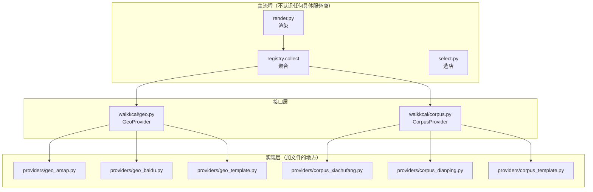

# 扩展开发 · 换地图 / 换语料

> **本文给谁看**：想把本项目的**地图**或**语料**换成别的同学。
> 只想「跑起来看看」的话，看根目录 [`README.md`](../README.md) 就够了。

---

## 30 秒回答

| 你想换 | 要改什么 | 要改几处 |
|---|---|---|
| **渠道**（启用 / 禁用某个数据源）| 设 1 个环境变量 `WALKKCAL_PACKS` | **主流程 0 处** |
| **地图**（高德 → 百度/腾讯） | 加 1 个文件 `providers/geo_百度.py`，设 1 个环境变量 | **主流程 0 处** |
| **语料**（下厨房 → 大众点评/薄荷） | 加 1 个文件 `providers/corpus_大众点评.py`，设 1 个环境变量 | **主流程 0 处** |

**不用改 `render.py` / `select.py` / `registry.py` 里的任何一行。**

---

## 架构：主流程只认接口，不认服务商



**关键点：地图和语料是**两个独立的接口**，互不依赖。**
你可以只换地图（用百度找店）而保留下厨房语料，也可以只换语料。

---

## 一、换地图（3 步）

### 步骤

```bash
# ① 复制模板
cp walkkcal/providers/geo_template.py walkkcal/providers/geo_百度.py

# ② 实现**三个必填**方法 + 若干**可选**能力
#      nearby_dining()      找店                        （必填）
#      walk_route()         真实路网步行距离             （必填）
#      industries_of()      ★ 私有类目 → 归一化业态      （必填，别省）
#      walk_route_batch()   批量算路（★ 强烈建议，见下）  （可选）
#      geocode()            地址 → 坐标                  （可选，shoot.py 需要）
#      describe_point()     坐标 → 地名                  （可选，长图标题需要）

# ③ 在 walkkcal/geo.py 的 get() 里加一行
#    if key in ('baidu', u'百度'):
#        from walkkcal.providers.geo_baidu import BaiduProvider
#        return BaiduProvider()

# ④ 设环境变量，跑
export WALKKCAL_GEO=baidu
export BAIDU_AK=你的key
python walkkcal/fetch_pois_at.py 31.2209 121.4700 500 k11
```

### 方法一览

| 方法 | 必填？ | 做什么 | 返回 |
|---|---|---|---|
| `nearby_dining(lon, lat, radius)` | ✅ | 找周边**餐饮**店 | 归一化门店列表 |
| `walk_route(from, to)` | ✅ | **真实路网**步行距离 | `{'distance_m': 121, 'duration_s': 96}` |
| `industries_of(raw)` | ✅ | 私有类目 → 归一化业态 | `[u'日料']` 或 `[]` |
| `walk_route_batch(origin, dests)` | 可选 | **批量**算路（省请求数） | 与入参等长的列表，单项失败为 `None` |
| `geocode(address, city)` | 可选 | 地址 → 坐标 | `{'lon','lat','formatted','level'}` 或 `None` |
| `describe_point(lon, lat)` | 可选 | 坐标 → 地名 | `u'上海·静安区宝山路街道'` 或 `None` |

★ **`walk_route_batch` 为什么强烈建议实现**：
  不实现的话，抓取会退化成**逐店请求**，而限速器把墙钟时间钉死在请求数上 ——
  实测凌河路场景 104 家 × 1.2 秒 = **125 秒**，占整个抓取的 93%。
  实现后是 **2 次请求 ≈ 2.4 秒**（高德 `/v3/distance` 一次收 100 个起点；
  百度 `routematrix/v2/walking` 是「起点数 × 终点数 ≤ 50」）。

★ 所有可选能力**基类都有默认实现**：`walk_route_batch` 退化为逐个调
  `walk_route`，`geocode` / `describe_point` 返回 `None` ——
  不实现也能跑，只是慢一些、少几个功能。

★ 实现批量时的红线：
  **必须走你自己 provider 的 `_call_retry()`**（进而过限速器）。
  批量省的是「请求数」，不是「并发许可」—— 地图配额按**并发**算，
  绕过限速器会被限流/告警（百度实测贴 3 QPS 就收到告警短信）。

**标准门店结构**（所有 provider 必须归一化成这个）：

```python
{
    'id':            'B0HGZZ273A',      # 唯一 id
    'name':          '惠香缘红烧牛肉面',
    'lon': 121.4698, 'lat': 31.2502,    # ★ GCJ-02 坐标
    'distance_m':    121,               # 到中心距离（米）
    'address':       '虬江路1230',
    'category_hint': u'牛肉面',          # ★ 品类线索 → 分层估算 L3 靠它
    'dish_hints':    [u'红烧牛肉面'],     # ★ 推荐菜线索
    'raw':           {...},             # 原始响应，便于排查
}
```

★ 带 `★` 的两个字段**尽量填**：
- `category_hint` 让「分层估算」的 L3 层能兜底（否则只能靠菜名猜）
- `dish_hints` 是卡片上要展示的推荐菜

### ★★ 还有一个必填字段：`industries`（业态）

各家的**类目体系完全不一样**，所以翻译必须在本文件里做完：

| 服务商 | 原始类目 | 你要翻成 |
|---|---|---|
| 高德 | `餐饮服务;外国餐厅;日本料理` | `['日料']` |
| 百度 | `美食;日本料理` | `['日料']` |

**归一化词表**（12 个，定义在 `walkkcal/filter.INDUSTRIES`）：

```
快餐 · 小吃 · 面馆 · 西餐 · 日料 · 韩餐 · 东南亚
火锅烧烤 · 咖啡 · 茶饮 · 面包甜点 · 中餐本帮
```

**报不出来就返回 `[]`**（合法）—— 上层会退到 `category_hint` 和店名兜底。
**别瞎猜**：猜错会污染筛选。

> ⚠️ **实测代价**：K11 218 家里 171 家次靠 `industries` 分类。
> 不产出这个字段 → 只剩店名兜底 → **覆盖率 82% → 28%**。
> 自检：`walkkcal/filter.coverage(stores)`。

📖 完整说明 → [`业态归类.md`](业态归类.md)

### 换地图会遇到的坑（我们踩过）

| 坑 | 后果 | 处理 |
|---|---|---|
| **坐标系不同**（高德 GCJ-02 / 百度 BD-09） | 门店整体偏 **500m 量级** | provider 里转坐标（`geo_baidu.py` 已给实现） |
| **经纬度顺序**（高德 `lng,lat` / 百度 `lat,lng`） | 位置跑到地球另一边 | 归一化时统一成 `lon,lat` |
| **步行路径要「轻量级」版**（百度） | 普通版一次调用贵 | 用 `/directionlite/` |
| **推荐菜默认不返回**（百度） | 卡片没菜可显示 | 另调详情接口取 `dish_tag` |

---

## 二、换语料（3 步）

### 步骤

```bash
# ① 复制模板
cp walkkcal/providers/corpus_template.py walkkcal/providers/corpus_大众点评.py

# ② 实现 heat(dish)
#    把「菜名 → 热量」翻译成我们的标准结构

# ③ 在 walkkcal/corpus.py 的 get() 里加一行

# ④ 设环境变量
export WALKKCAL_CORPUS=dianping
```

### 你要实现的只有一个方法

```python
def heat(self, dish):
    return {'kcal': 450, 'label': u'点评数据', 'source': self.name}
    # 拿不到就 return None —— 别编
```

### ★ 最重要的一点：换语料**不会**把覆盖率打回原形

因为查热量是**分层**的：

```
lookup(dish, store_hint)
  ├─ L1  你的语料源（provider.heat）     → 标你的标签     ±25%
  ├─ L2  菜名关键词定品类（prior.py）     → 标「品类估算」  ±35%
  ├─ L3  门店类型定品类（prior.py）       → 标「同类估算」  ±45%
  └─ L4  都不中                            → 弃权
```

**L2/L3 与语料源完全无关，永远生效。**
所以即便你接的语料只覆盖 30%，界面上也不会一片「算不出」。

实测（K11 周边 535 条真实推荐菜）：只用语料 79% → 加 L2/L3 后 **98%**。

---

## 三、常见场景速查

### Q：我只想启用麦当劳（不要周边餐厅）？
```bash
WALKKCAL_PACKS=mcd
```

### Q：我只想启用周边餐厅（不要麦当劳，即「只要高德」）？
```bash
WALKKCAL_PACKS=nearby
```

### Q：我想两个都要？
```bash
WALKKCAL_PACKS=mcd,nearby      # 不设也是这个默认值
```
多个渠道会**合并**进同一个列表。跑起来会打印「源装配」那行，告诉你谁在供数据：
```
源装配：麦当劳(店✓ 菜✓ 热✓官方) ｜ 周边餐厅(店✓ 菜✓ 热✓估算)
```

### Q：我想加一个新的连锁品牌（比如星巴克）？
1. 照 [`../packs/pack_template.py`](../packs/pack_template.py) 写一个 `pack_starbucks.py`
2. 在 [`../packs/registry.py`](../packs/registry.py) 的 `CHANNELS` 里加一行：
   `CHANNELS['sbux'] = lambda: StarbucksPack()`
3. `WALKKCAL_PACKS=mcd,sbux`

★ 加渠道**不用改** `render.py` / `select.py` / `registry.collect()`。

### Q：我买了大众点评的数据，怎么接？
1. 把数据导出成 `data/dianping_heat.json`，格式 `{"菜名": 卡数}`
2. `corpus_dianping.py` 里已经写好了读这个表的代码（填一下路径即可）
3. `export WALKKCAL_CORPUS=dianping`

★ 只要你的表能给出「菜名 → 卡数」，**换语料不影响 L2/L3 兜底** ——
  覆盖率不会因为你换源而掉回 79%。

### Q：我有薄荷健康的 API 呢？
照着 `corpus_dianping.py` 抄一个 `corpus_boohee.py`，
`heat()` 里调 API。**不用改别的地方。**

### Q：我只想用自己的 Excel 表？
导出成 json 放 `data/your_heat.json`，照 `corpus_template.py` 抄 20 行。

### Q：我想同时用多个语料源（下厨房 + 点评）？
在 `corpus.py` 的 `lookup()` 里按顺序试：
```python
for prov in [prov_a, prov_b]:
    r = prov.heat(dish)
    if r: return r
```
这就是**多源加权**的挂载点。★ 提醒：我们实测过，
多渠道加权对「地方菜缺口」**无效**（三渠道同时查不到「奥灶面」），
详见 [`数据源与误差.md`](数据源与误差.md)。

### Q：图上怎么没有星巴克 / 喜茶？我想看饮品店
默认会隐去「**只卖喝的**」——咖啡·茶饮店里推荐菜全是饮品的那种。

```bash
WALKKCAL_DRINK=1 python walkkcal/render.py        # 全放出来
WALKKCAL_FILTER=咖啡 python walkkcal/render.py    # 只点名要看咖啡店（强制包含）
```

判据是**两层**（见 [`设计取舍.md`](设计取舍.md) 第 13 节）：
① 店铺挂着饮品类目 **且 没有**任何正餐业态；② 推荐菜里没有「能当一餐的固体」。
两层都过才隐去 —— 所以 **Tims（有贝果三明治）会保留**，
**Chili's（被高德误标成咖啡店的美式餐厅）也会保留**。

想调词表？改 `walkkcal/filter.py::MEAL_WORDS` 一处即可。

### Q：渲染有点慢？
第 63 轮做过一次定位：真凶是 `geo.get()` 没有缓存 ——
255 家门店各新建一个 provider，每个都在 `__init__` 里
`ssl.create_default_context()`（加载整个系统证书库 ≈ 13 ms）→ **额外 3.4 秒**。

现在 `geo.get()` 按名字缓存实例，且 provider 的 SSL 上下文改**惰性创建**
（只在真发请求时才建）。渲染从 **4.5 s → 0.5 s**。

> 结论：**纯本地翻译（`industries_of`）不该付网络栈的钱。**
> 如果你新写的 provider 在 `__init__` 里做了重活，照这个思路改成惰性。

---

## 四、为什么不把地图/语料混在主流程里

这是我们**刻意**的架构选择：

| 原则 | 为什么 |
|---|---|
| **接口与实现分离** | 主流程只 `import walkkcal.geo`，不 `import requests`、不硬编码任何域名 |
| **一个服务商的所有知识只在一个文件里** | 高德的域名/端点/字段名/坐标系**只在 `geo_amap.py`**。换百度时，`geo_amap.py` 原样留着都行 |
| **桩文件也是文档** | `geo_baidu.py` 没实测过就老实标「桩」，并写清要填哪几个字段 —— 不假装能用 |
| **环境变量切换，不是改代码** | `WALKKCAL_GEO` / `WALKKCAL_CORPUS`，一行搞定 |

**判断标准很简单：**
如果你要接一个新地图，需要修改的文件超过 1 个 —— 那是我们的架构没做好，请提 issue。

---

## 五、文件地图

| 文件 | 作用 |
|---|---|
| `walkkcal/geo.py` | 地图接口 + 注册表（**加新地图在这里加一行**） |
| `walkkcal/corpus.py` | 语料接口 + 注册表 + 分层 `lookup()` |
| `walkkcal/providers/geo_amap.py` | 高德实现（默认，已实测）+ **高德类目 → 业态**的翻译 |
| `walkkcal/providers/geo_baidu.py` | 百度（端点/坐标转换/类目翻译都已写好；**唯一待实测**的是详情接口的推荐菜字段名）|
| `walkkcal/providers/geo_template.py` | ★ 新地图照这个抄 |
| `walkkcal/providers/corpus_xiachufang.py` | 下厨房（默认，已实测） |
| `walkkcal/providers/corpus_dianping.py` | 大众点评/薄荷（桩） |
| `walkkcal/providers/corpus_template.py` | ★ 新语料照这个抄 |
| `walkkcal/filter.py` | 业态筛选（**不认识任何服务商**）+ `coverage()` 自检 |
| `walkkcal/prior.py` | 分层估算（L2/L3，与语料无关） |
| `packs/` | **门店级**数据源（麦当劳 / 周边餐厅）—— 见 [`../packs/README.md`](../packs/README.md) |

> 三层的关系：
> `geo` 管「店在哪」→ `packs` 管「有哪些店」→ `corpus` 管「菜多少卡」。

---

## 换服务商时，哪些地方**不该**改

这个问题曾经踩过坑，所以单独写一节。完整审计见
[`服务商边界.md`](服务商边界.md)。

| 文件 | 换地图时 | 换语料时 |
|---|---|---|
| `walkkcal/providers/geo_*.py` | ★ **要加一个** | 不动 |
| `walkkcal/providers/corpus_*.py` | 不动 | ★ **要加一个** |
| `walkkcal/geo.py` / `corpus.py` | 注册表加一行 | 注册表加一行 |
| `walkkcal/filter.py` / `prior.py` / `select.py` | **不动** | **不动** |
| `walkkcal/snapshot.py` | **不动**（自动兼容旧格式） | 不动 |
| `packs/` | **不动** | **不动** |
| `render.py` / `entry/` | **不动** | **不动** |

> **改了主流程 = 架构退化了。** 加一条测试守住它：
> `tests/test_gate.py` 里的 `test_provider_boundary`（静态扫描）
> 与 `test_map_swap_end_to_end`（假地图端到端）。

**别忘的第 ③ 个方法**：`GeoProvider.industries_of(raw)` —— 把你自己地图的
私有类目翻译成归一化业态。没有它，你这家地图的店只有店名能兜底，
分类覆盖率会从 82% 掉到 28%（K11 实测）。

---

## 别把 Key 的并发打满（★ 血泪）

地图服务商的配额大多按**并发**算，不是按总量算。而且**超了不报错** ——
百度个人 AK 并发上限 3，我们贴着 3 QPS 跑了几百次，只收到一条短信告警：
「并发量超过上限 3/3，需要回复工单」。

所以：**限速放进 provider 的 `_call()` 里，任何调用方都绕不过。**

```python
from walkkcal.geo import new_limiter

class YourProvider(GeoProvider):
    def __init__(self, key=None):
        self.limiter = new_limiter()          # 默认 1 秒/请求
        self.min_interval = self.limiter.min_interval

    def _call(self, path, **q):
        ...
        self.limiter.wait()                   # ★ 就这一行
        return json.loads(...)
```

```bash
WALKKCAL_MIN_INTERVAL=2   WALKKCAL_MAX_REQUESTS=1000   # 可调
```

`max_requests` 是**保险丝**：跑飞时抛错，而不是静默把配额打满。

★ 参考实现：`walkkcal/providers/geo_amap.py`（1.2 秒/请求）、
`geo_baidu.py`（1.0 秒/请求 + 限流长退避）。

---

## 除了麦当劳和高德，还能从哪拿推荐菜

> 这一节给「想自己接一条新路」的人。
> **我们替你查过了 —— 包括查不出结果的那些**，都写在下面，免得你重走一遍。

### 结论：能拿到「店 → 菜名」的只有四类来源

| 类别 | 是什么 | 门槛 | 现状 |
|---|---|---|---|
| **A 地图 POI 附带的评价内容** | 高德 POI 的 `tag`（官方定义：**特色菜**）| 免费 Key | ✅ 默认在用 |
| **B 品牌官方** | 麦当劳 MCP 官方营养表 | 实名 | ✅ 默认在用 |
| **C 商家自己的经营系统** | 美团 / 饿了么 / 餐道 | 企业资质 + 商家授权 | ⚠️ 只服务「你自己那家店」|
| **D 自带菜品表** | `data/menu.json` | 零 | ✅ **已实现** |

★ **没有第五类。** 别的平台都没有这个字段 —— 见文末的「不能用」清单。

---

### C · 商家侧：能做，但只服务商家自己

如果你的身份是**店主**（而不是想查全城），这三条是通的：

| 平台 | 端点 | 门槛 |
|---|---|---|
| 美团餐饮系统 | `rms/pos/api/v1/poi/goods/wm/rel/list`（外卖菜品关联）| 需业务授权；参数 `orgId` = **你自己的门店** |
| 饿了么开放平台 | `eleme.product.item.getItem` | 需商家授权 code，**只能拿该商家自己的数据** |
| 餐道等餐饮 SaaS | MCP 形态 | 需商家授权 |

**共同点**：作用域是「**你被授权的门店**」，不是「附近的门店」。所以拿它做
「查周边任意餐厅」不可行 —— 但拿它**导出自己的菜单**完全可行，导出来存成
`data/menu.json` 就接进来了（见 D）。

---

### D · 自带菜品表（★ 推荐，零门槛）

放进 `data/menu.json`：

```json
{
  "味香斋(雁荡路店)": ["麻酱捞面", "小牛汤", "炸猪排"],
  "B0HGZZ273A":      ["红烧牛肉面"]
}
```

- 键可以是**店铺 id** 或**店名**；匹配顺序：id → 完整店名 → 去分店后缀
- 地图**给了**推荐菜时不覆盖（地图的更权威）
- 热量仍走 `corpus.lookup()` 的分层兜底 —— 自带表只给菜名，不给卡数

**这张表从哪来？三条现成的：**

1. **手工整理** —— 几十家常去的店，半小时够用
2. **商家资质导出** —— 见上面的 C，从美团/饿了么导自家菜单
3. **拍菜单 + OCR** —— 见下，最通用

---

### ★ 一条容易被忽略的路：把菜单「拍」下来

菜单本质是**印刷品**。所以最通用的获取方式不是 API，而是 OCR：

| 方案 | 特点 |
|---|---|
| **PaddleOCR / Tesseract** | 本地离线、零成本，中文识别够用 |
| Google Cloud Vision（`DOCUMENT_TEXT_DETECTION`）| 精度高，需联网 + Key |
| Amazon Textract | 专门识别**表格与键值对**，「菜名 + 价格」正好是它的强项 |

流程只有三步：

```
拍 / 扫描菜单  →  OCR  →  存成 data/menu.json  →  完事
```

★ **合规上最干净**：处理的是**你手里那份实物菜单**，不涉及抓取任何平台。

---

### 明确「不能用」的（我们查过，别再花时间）

| 渠道 | 结论 | 依据 |
|---|---|---|
| 百度地图 | **无菜品字段** | 实测 `/place/v2/detail` 的 `detail_info` 全部键 |
| 腾讯位置服务 | **无菜品字段** | 官方字段表只有 名称 / 地址 / 坐标 / 类别 / 电话 |
| 大众点评 POI 搜索 | **能查周边，但没有菜** | 出参只有 `name` / `branchname` / `distance` / `shopaddress` / `category` |
| 美团餐饮系统 · 外卖菜品 | **只能查自家门店** | 参数 `orgId` 必填；连「查询**授权**门店列表」的作用域也是「你被授权的门店」 |
| 美团个人开发者 MCP | **目录里没有这项能力** | 能力目录（到店/外卖/服务零售/餐饮系统）全部是商家经营侧 |
| Google Places | 只有 `servesLunch` / `servesBeer` 这类**布尔属性** | 没有菜品目录，且不覆盖中国大陆 |
| **爬外卖 / 点评网页** | ❌ **别做** | 平台已上行为式验证码 + 设备指纹；近年有多起判例支持平台方；开源/参赛项目被贴这个标签是**负分** |

> ★ **「不能用」这张表比上面那张更有价值** —— 它是三轮调研换来的，直接省掉你的重复劳动。

---

### 附：海外有一条成熟产业（仅作参考）

`FoodDataScrape`、`Foodspark` 这类服务商，按城市 / 半径采集 Uber Eats、DoorDash、
Zomato 的**完整菜单**，以 JSON / CSV / REST API 交付。

**不覆盖中国**，列出来是因为它说明一件事：**「菜单数据」是一个真实存在的采购品类**。
将来若要做中国市场，形态大概率也是这样 —— 而不是等某个平台开放。

---

★ 仓库**不包含任何抓取代码**：数据怎么来是你的选择，责任也在你这边。
